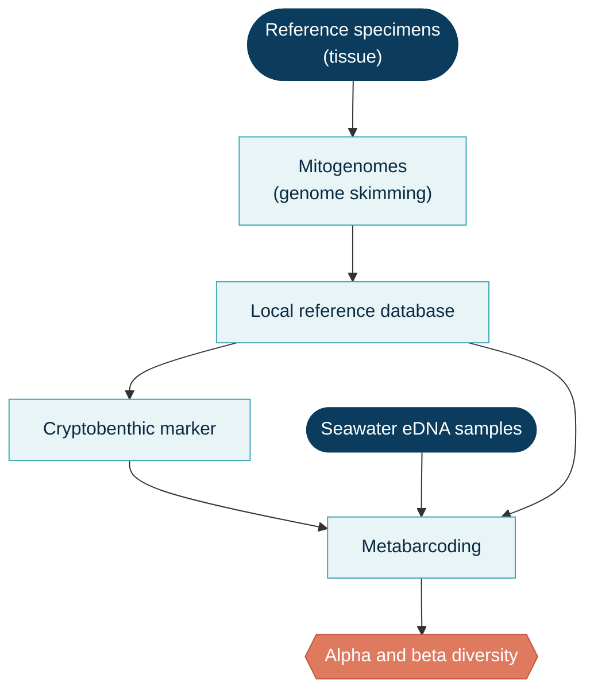

<p align="center">
  
</p>

<p align="center">
  
  
  
  
  
</p>

<p align="center">
  <b>Revealing the hidden diversity of Gulf of California reefs</b>
</p>

---

Cryptobenthic reef fishes are small, hidden and astonishingly diverse. In the Gulf of California they include gobies, blennies, triplefins, clingfishes and their relatives, many of them endemic. Because they live inside the reef rather than above it, visual censuses miss most of them, and standard fish eDNA markers detect only a handful.

This repository holds the environmental DNA (eDNA) component of **Objective 1 of project CBF-2026-4124**: building the molecular tools needed to detect cryptobenthic fishes with eDNA, and using them to describe the spatial structure of the assemblage across the Gulf of California.

> **En español.** Componente de ADN ambiental (eDNA) del Objetivo 1 del proyecto CBF-2026-4124: herramientas moleculares para detectar peces criptobentónicos arrecifales con eDNA y su aplicación para describir la estructura comunitaria espacial (diversidad alfa y beta) en el Golfo de California.

## What this objective does

<table>
  <tr>
    <td width="33%" valign="top">
      <h3>eDNA community structure</h3>
      Alpha and beta diversity of the cryptobenthic assemblage along the Gulf from eDNA metabarcoding.
      <br><br><code>analyses/edna_community</code>
    </td>
    <td width="33%" valign="top">
      <h3>eDNA blind spots</h3>
      How complete are public reference databases for cryptobenthic species, and how well do standard fish primers amplify and resolve them?
      <br><br><code>analyses/reference_gaps</code>
    </td>
    <td width="33%" valign="top">
      <h3>A marker for the hidden half</h3>
      A cryptobenthic-specific mitochondrial marker designed from new mitogenome references for the Gulf assemblage.
      <br><br><code>analyses/marker_design</code>
    </td>
  </tr>
</table>

## Workflow



## Repository map

| Folder | Contents |
| --- | --- |
| [`analyses/edna_community`](analyses/edna_community) | Alpha and beta diversity from eDNA metabarcoding |
| [`analyses/reference_gaps`](analyses/reference_gaps) | Reference coverage, primer mismatches and taxonomic resolution |
| [`analyses/marker_design`](analyses/marker_design) | Cryptobenthic-specific mitochondrial marker |
| [`data`](data) | Sample metadata; sequences are deposited in NCBI |
| [`protocols`](protocols) | Field and laboratory protocols |
| [`scripts`](scripts) | Shared utilities |

## Getting started

```bash
git clone https://github.com/taniavaldiviac/cryptobenthic-gulf-genomics.git
cd cryptobenthic-gulf-genomics
pip install -r requirements.txt

# reference coverage, primer and resolution analysis
python analyses/reference_gaps/cripticos_insilico.py --email you@example.org --outdir analyses/reference_gaps/results
```

An NCBI API key (`--api-key`) speeds up queries from 3 to 10 requests per second.

## Data

Raw sequence data are not stored here. eDNA reads and new mitogenome references will be deposited in NCBI under a BioProject linked to each publication; accessions will be listed in [`data/README.md`](data/README.md). Result tables are added to each analysis folder when the corresponding manuscript is submitted.

## Project

<table>
  <tr>
    <td valign="top"><b>Project</b></td>
    <td>Del genoma al ensamblaje de especies: evaluación de los procesos evolutivos neutrales, selectivos y funcionales que estructuran la biodiversidad en ambientes marinos (CBF-2026-4124)</td>
  </tr>
  <tr>
    <td valign="top"><b>Funding</b></td>
    <td>SECIHTI, Ciencia Básica y de Frontera 2026</td>
  </tr>
  <tr>
    <td valign="top"><b>Host institution</b></td>
    <td>Centro de Investigaciones Biológicas del Noroeste (CIBNOR), La Paz, Baja California Sur, Mexico</td>
  </tr>
  <tr>
    <td valign="top"><b>eDNA component lead</b></td>
    <td>Tania Valdivia Carrillo</td>
  </tr>
  <tr>
    <td valign="top"><b>Principal investigator</b></td>
    <td>Fausto Valenzuela Quiñonez</td>
  </tr>
</table>

## License

Code: [MIT](LICENSE). Data, result tables, figures and documentation: [CC BY 4.0](LICENSE-DATA.md).
